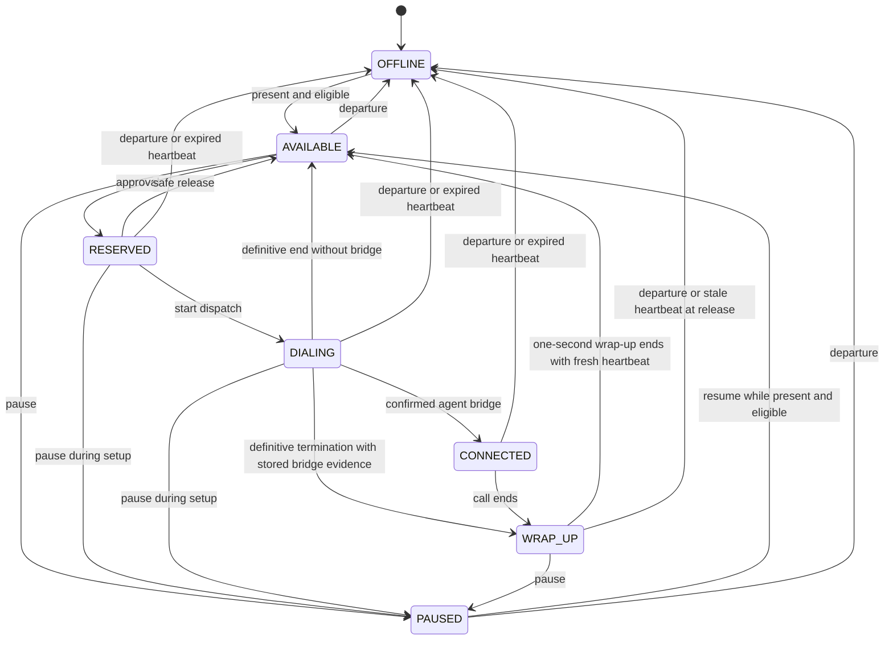

# Agent state machine

Progressive and predictive pacing use the same agent transitions. The diagram includes the transitions the validator permits, including presence changes represented by the simulator. The demo seeds agents directly as `AVAILABLE` with an initial heartbeat. The worker reads current presence from the stored state and heartbeat.

The validator rejects transitions absent from the diagram, including `OFFLINE → RESERVED`, `AVAILABLE → CONNECTED`, and `CONNECTED → AVAILABLE`. The last path requires wrap-up first. An answering borrower does not move an agent from `DIALING` to `CONNECTED`. That step requires bridge evidence consistent with the agent's observed presence.

The allocator requires an `AVAILABLE` agent with a heartbeat no older than five seconds and no nonterminal attempt. It locks candidate rows and skips any held by another transaction. PostgreSQL also prevents two nonterminal attempts from owning the same agent. Only paired agents are updated. If a later write fails, the reservation is rolled back and the previous state remains visible.

The forecast counts all freshly staffed agents, including busy agents, to estimate future demand. The transition to `RESERVED` still requires live eligibility at approval time. Forecast releases do not change agent state or confer reservation eligibility.

Presence and ownership are separate. Before dispatch, the worker cancels locally if the agent is unavailable. After dispatch intent, loss of the agent triggers provider cancellation. An ambiguous cancel keeps both reservations and schedules reconciliation. Completions preserve `OFFLINE` and `PAUSED`. A connected agent enters `WRAP_UP` on definitive termination and is released as `AVAILABLE` only while fresh. An answered call after agent loss is recorded as an incident.

The `agent_loss` scenario removes 40 of 100 agents at t=2 s. Twenty send an explicit `OFFLINE` update and the other twenty stop sending heartbeats. The scenario observed the first group at t=2 s and the second at t=7 s, with no new approvals for either group once they became ineligible. Its utilization denominator uses the scheduled departure for both groups, including the interval before PostgreSQL detects the missed heartbeats.
