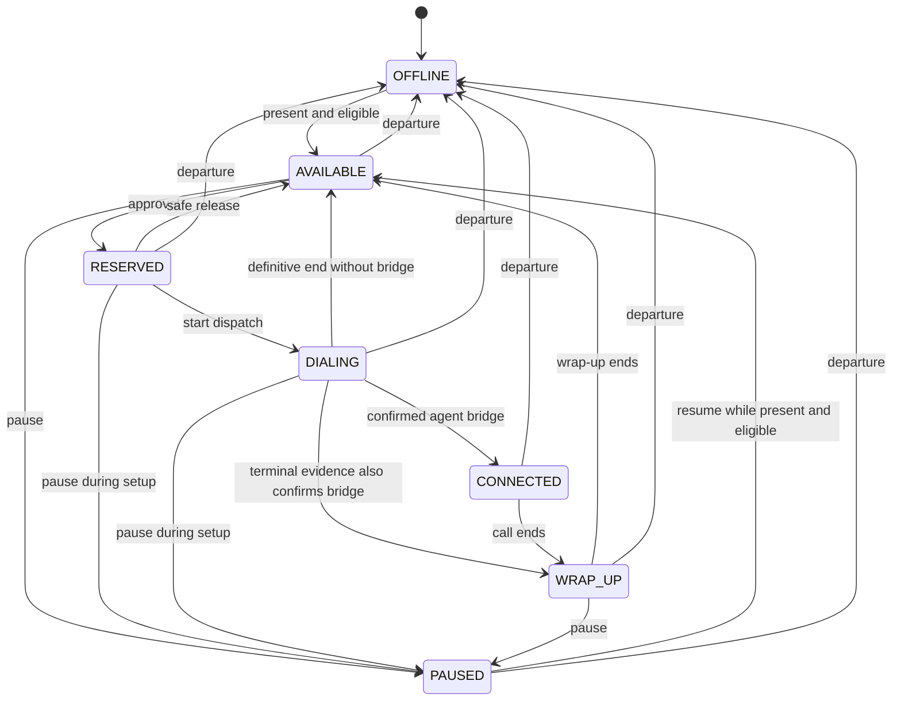

# Agent state machine

Phase 1 defines and validates these lifecycle edges. The operational guards, such as heartbeat checks and releasing ownership, will be enforced by the allocator and worker in later phases.

`OFFLINE → RESERVED` and `AVAILABLE → CONNECTED` are invalid. An answering borrower does not move an agent from `DIALING` to `CONNECTED`. That transition requires evidence the agent joined the call.

Presence and ownership are separate. An agent may become `OFFLINE` before the provider confirms a call has ended. That attempt still owns the agent and borrower. A returning agent becomes `AVAILABLE` only after the unresolved attempt is cleared and the agent is otherwise eligible. If a pause or departure happens during setup, the planned worker will cancel or reconcile the attempt before releasing ownership.
