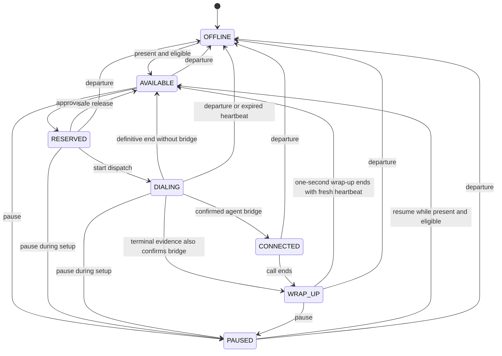

# Agent state machine

Progressive and predictive pacing use these same reservation, dialing, bridge, and release transitions. Presence inputs come from the stored agent state and heartbeat. The demo seeds an initial heartbeat.

`OFFLINE → RESERVED` and `AVAILABLE → CONNECTED` are invalid. An answering borrower does not move an agent from `DIALING` to `CONNECTED`. That transition requires evidence the agent joined the call.

The allocator requires an `AVAILABLE` agent with a heartbeat no older than five seconds and no nonterminal attempt. It locks candidate rows and skips any held by another transaction. PostgreSQL also prevents two nonterminal attempts from owning the same agent. Only paired agents are updated. If a later write fails, the reservation is rolled back and the previous state remains visible.

The forecast counts all freshly staffed agents, including busy agents, to estimate future demand. The transition to `RESERVED` still requires live eligibility at approval time. Forecast releases do not change agent state or confer reservation eligibility.

Presence and ownership are separate. Before dispatch, the worker cancels locally if the agent is unavailable. After dispatch intent, loss of the agent triggers provider cancellation. An ambiguous cancel keeps both reservations and schedules reconciliation. Completions preserve `OFFLINE` and `PAUSED`. A connected agent enters `WRAP_UP` on definitive termination and is released as `AVAILABLE` only while fresh. An answered call after agent loss is recorded as an incident.
