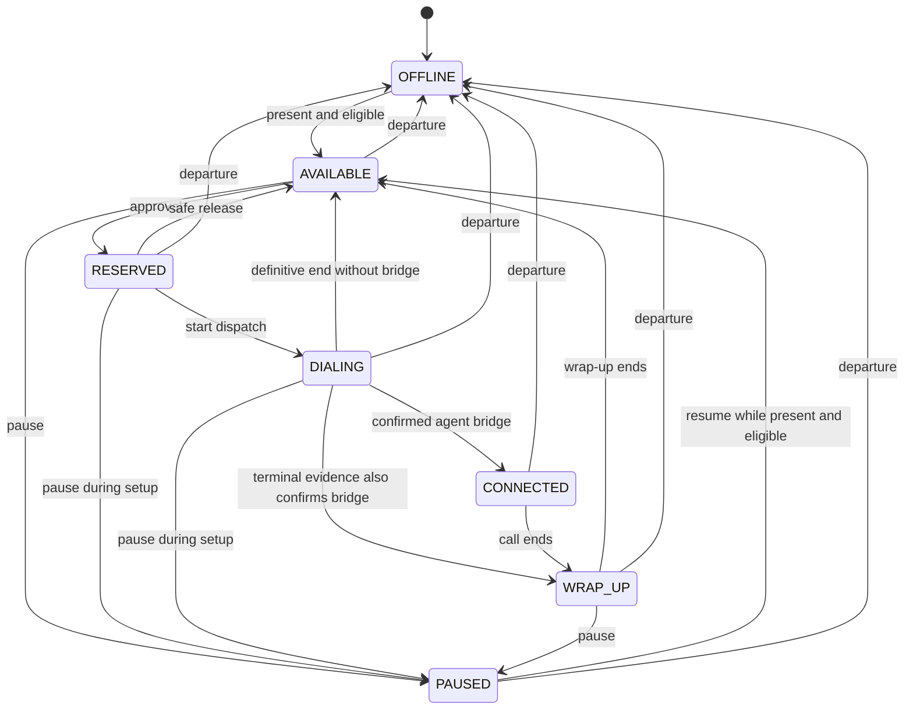

# Agent state machine

Phase 2 executes the `AVAILABLE → RESERVED` transition during approval. The other lifecycle edges are defined by the validator for later operational flows.

`OFFLINE → RESERVED` and `AVAILABLE → CONNECTED` are invalid. An answering borrower does not move an agent from `DIALING` to `CONNECTED`. That transition requires evidence the agent joined the call.

The allocator requires an `AVAILABLE` agent with a heartbeat no older than five seconds and no nonterminal attempt. It locks candidate rows and skips any held by another transaction. PostgreSQL also prevents two nonterminal attempts from owning the same agent. Only paired agents are updated. If a later write fails, the reservation is rolled back and the previous state remains visible.

Presence and ownership are separate. An agent may become `OFFLINE` before the provider confirms a call has ended. That attempt still owns the agent and borrower. A returning agent becomes `AVAILABLE` only after the unresolved attempt is cleared and the agent is otherwise eligible. If a pause or departure happens during setup, the planned worker will cancel or reconcile the attempt before releasing ownership.
