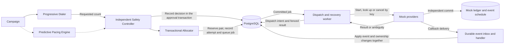

# SmartDialer architecture

Candidate 1 combines progressive dialing and predictive pacing with an independent hard Safety Controller. The prototype uses one Python package and PostgreSQL.

## Implementation through Phase 3

The migration CLI applies versioned SQL in order and records each applied version in `schema_migrations`. A database session lock serializes migration runs. Each migration's SQL and ledger entry commit together.

PostgreSQL stores campaigns, agents, borrowers, attempts, decisions, jobs, provider health, and the event inbox. The mock provider ledger and its event schedule use separate database connections and commits. Provider acceptance can therefore survive the dialer worker exiting before it records the result.

## Data flow

Solid arrows show the Phase 3 flow. Dashed arrows show the planned predictor.

| Component | Responsibility |
| --- | --- |
| Progressive dialer | Request one call per available agent in its snapshot |
| Predictive pacing engine | Planned. Forecast demand and explain its requested count |
| Safety Controller | Validate the request, check current eligibility and capacity in PostgreSQL, and persist approval, reduction, or rejection |
| Transactional allocator | Reserve one agent and borrower per approved attempt and commit ownership with a dispatch job |
| Worker and recovery | Lease approved work, persist dispatch intent, check agent and provider status, and recover expired leases |
| Provider adapters and event handler | Store mock calls and callbacks, persist deliveries before acknowledgement, and apply evidence without regressing state |
| Simulation and load tests | Planned. Compare the pacing modes using seeded scenarios and measure contention against PostgreSQL |

## Safety boundary

The progressive pacer receives an advisory snapshot and returns a request. The Safety Controller opens one transaction, locks campaign configuration for reading, and claims the request ID. The allocator locks available agents first, then eligible borrowers, in ID order with `FOR UPDATE SKIP LOCKED`. It checks agent heartbeat age and excludes both kinds of owner when they already belong to a nonterminal attempt. Approval is bounded at 50 pairs per decision. Separate partial unique indexes enforce exclusive agent and borrower ownership, including for `UNKNOWN` attempts.

The decision count, ownership changes, attempt, and durable job commit together. A retry with the same request ID for the same campaign and mode returns the original result. The worker rechecks agent freshness, campaign status, and provider cooldown before a start. Approval, committed dispatch intent, provider acceptance, borrower answer, and agent bridge have separate records.

After dispatch intent, the provider call runs outside the dialer transaction. A worker result can update the attempt only while its lease owner and generation still match and the lease is live. The worker reclaims expired leases and reconciles possibly sent calls using the same provider key. The inbox commits before acknowledging delivery. Processing an inbox row, changing ownership, and marking the row processed share one transaction.
