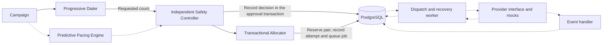

# SmartDialer architecture

Candidate 1 combines progressive dialing and predictive pacing with an independent hard Safety Controller. The prototype uses one Python package and PostgreSQL.

## Implementation through Phase 2

The migration CLI applies versioned SQL in order and records each applied version in `schema_migrations`. A database session lock serializes migration runs. Each migration's SQL and ledger entry commit together.

PostgreSQL stores campaigns, agents, borrowers, call attempts, pacing decisions, and dispatch jobs. `domain.py` defines allowed lifecycle edges. `providers/base.py` defines the provider contract for the next phase.

## Data flow

Solid arrows show the Phase 2 flow. Dashed arrows show planned interactions.

| Component | Responsibility |
| --- | --- |
| Progressive dialer | Request one call per available agent in its snapshot |
| Predictive pacing engine | Planned. Forecast demand and explain its requested count |
| Safety Controller | Validate the request, check current eligibility and capacity in PostgreSQL, and persist approval, reduction, or rejection |
| Transactional allocator | Reserve one agent and borrower per approved attempt and commit ownership with a dispatch job |
| Worker and recovery | Planned. Dispatch approved work, look up uncertain outcomes, and continue after worker failure |
| Provider adapters and event handler | Planned. Supply provider evidence, persist it durably, and apply each transition at most once |
| Simulation and load tests | Planned. Compare the pacing modes using seeded scenarios and measure contention against PostgreSQL |

## Safety boundary

The progressive pacer receives an advisory snapshot and returns a request. The Safety Controller opens one transaction, locks campaign configuration for reading, and claims the request ID. The allocator locks available agents first, then eligible borrowers, in ID order with `FOR UPDATE SKIP LOCKED`. It checks agent heartbeat age and excludes both kinds of owner when they already belong to a nonterminal attempt. Approval is bounded at 50 pairs per decision. Separate partial unique indexes enforce exclusive agent and borrower ownership, including for `UNKNOWN` attempts.

The decision count, ownership changes, attempt, and durable job commit together. A retry with the same request ID for the same campaign and mode returns the original result. A failed write rolls back all changes. Phase 2 records requests and approvals. A future worker will consume committed jobs and record dispatch and provider outcomes separately.
