# SmartDialer architecture

Candidate 1 combines progressive dialing and predictive pacing with an independent hard Safety Controller. The prototype uses one Python package and PostgreSQL.

## Phase 1 implementation

The migration CLI applies versioned SQL in order and records each applied version in `schema_migrations`. A database session lock serializes migration runs. Each migration's SQL and ledger entry commit together.

PostgreSQL stores campaigns, agents, borrowers, and call attempts. The schema checks valid state values and requires an attempt's agent and borrower to belong to the same campaign as the attempt. `domain.py` defines allowed lifecycle edges. `providers/base.py` defines normalized provider results and events. Live allocation and state changes driven by a worker are planned for later phases.

## Planned data flow

```mermaid
flowchart LR
    Campaign --> Progressive[Progressive Dialer]
    Campaign --> Predictive[Predictive Pacing Engine]
    Progressive -->|Requested count| Safety[Independent Safety Controller]
    Predictive -->|Requested count| Safety
    Safety --> Allocator[Transactional Allocator]
    Allocator -->|Approved attempt, ownership, job| DB[(PostgreSQL)]
    DB -->|Committed job| Worker[Dispatch and recovery worker]
    Worker -->|Start, look up or cancel| Provider[Provider interface and mocks]
    Provider -->|Normalized events| Inbox[Event handler]
    Inbox -->|Persist evidence and apply state changes| DB
    Provider -->|Start and lookup results| Worker
    Worker -->|Persist result or reschedule| DB
```

| Component | Planned responsibility |
| --- | --- |
| Progressive dialer | Request one call per available agent in its snapshot |
| Predictive pacing engine | Forecast demand and explain its requested count |
| Safety Controller | Check current eligibility and capacity in PostgreSQL, then approve, reduce, reject, or fall back to progressive behavior |
| Transactional allocator | Reserve one agent and borrower per approved attempt and commit ownership with a dispatch job |
| Worker and recovery | Dispatch approved work, look up uncertain outcomes, and continue after worker failure |
| Provider adapters and event handler | Supply provider evidence, persist it durably, and apply each transition at most once |
| Simulation and load tests | Compare the pacing modes using seeded scenarios and test contention against PostgreSQL |

## Safety boundary

Both pacers submit requests to the Safety Controller. Only the worker can invoke the provider, using a committed job for an approved attempt. Requested, approved, dispatch started, provider accepted, borrower answered, and agent connected are separate milestones. An unresolved attempt retains its ownership until there is definitive evidence of its outcome.
