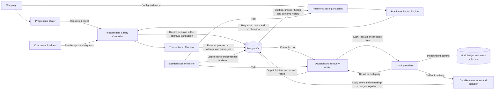

# SmartDialer architecture

Candidate 1 combines progressive dialing and predictive pacing with an independent hard Safety Controller. The prototype uses one Python package and PostgreSQL.

## Implementation through Phase 5

The migration CLI applies versioned SQL in order and records each applied version in `schema_migrations`. A database session lock serializes migration runs. Each migration's SQL and ledger entry commit together.

PostgreSQL stores campaigns, agents, borrowers, attempts, decisions, jobs, provider health, and the event inbox. The mock provider ledger and its event schedule use separate database connections and commits. Provider acceptance can therefore survive the dialer worker exiting before it records the result.

## Data flow

| Component | Responsibility |
| --- | --- |
| Progressive dialer | Request one call per available agent in its snapshot |
| Predictive pacing engine | Forecast demand from a read-only snapshot, using recent outcomes, current load, and an estimate of near-term agent releases |
| Safety Controller | Validate the request, check current eligibility and capacity in PostgreSQL, and persist approval, reduction, or rejection |
| Transactional allocator | Reserve one agent and borrower per approved attempt and commit ownership with a dispatch job |
| Worker and recovery | Lease approved work, persist dispatch intent, check agent and provider status, and recover expired leases |
| Provider adapters and event handler | Store mock calls and callbacks, persist deliveries before acknowledgement, and apply evidence without regressing state |
| Simulation and load tests | Reuse real pacing, allocation, and dispatch with a logical clock. Exercise allocation contention separately on independent PostgreSQL connections |

## Safety boundary

Both pacers receive advisory snapshots and return requests. After checking current campaign configuration and provider cooldown, the Safety Controller asks the allocator to lock available agents, then eligible borrowers, in ID order with `FOR UPDATE SKIP LOCKED`. It checks agent heartbeat age and excludes both kinds of owner when they already belong to a nonterminal attempt. Approval is bounded at 50 pairs per decision. Separate partial unique indexes enforce exclusive agent and borrower ownership, including for `UNKNOWN` attempts.

The decision count, ownership changes, attempt, and durable job commit together. A retry with the same request ID for the same campaign and mode returns the original result. The worker rechecks agent freshness, campaign status, and provider cooldown before a start. Approval, committed dispatch intent, provider acceptance, borrower answer, and agent bridge have separate records.

After dispatch intent, the provider call runs outside the dialer transaction. A worker result can update the attempt only while its lease owner and generation still match and the lease is live. The worker reclaims expired leases and reconciles possibly sent calls using the same provider key. The inbox commits before acknowledging delivery. Processing an inbox row, changing ownership, and marking the row processed share one transaction.

## Predictive inputs and audit

The PostgreSQL reader counts fresh, non-paused, non-offline agents as staffed. Available capacity is the subset whose state is `AVAILABLE` and who hold no active attempt. Every nonterminal attempt is counted once as connected, unknown, or pending setup. The outcome query selects up to 50 confirmed known terminal outcomes for the campaign and its provider, ordered by terminal time within the past 30 minutes. Measured talk time uses the interval from bridge to termination. The 85% target, five-second forecast, 20% denominator floor, 50-request cap, progressive fallback, and intermediate calculations are persisted in `pacing_decisions.inputs`. The controller uses live database state even if the forecast's provider and capacity snapshots are stale.

## Experiment boundaries

The simulator applies presence changes, processes due provider events and recovery, takes a pacing snapshot, and runs the normal approval and dispatch path at each tick. The clock, staffing schedule, and provider outcomes are synthetic. PostgreSQL runs the real migrations and transactions in a separate schema for each scenario and mode. The provider uses the existing mock ledger and callback delivery path. Trace comparison excludes random IDs and measures utilization over the configured observation window.

The load test uses a different disposable database. Its threads each own one PostgreSQL connection and start together. They run the same Safety Controller transaction and retain reservations through the final audit for unique owners, consistent decision counts, and one ready job per attempt. The timing includes worker connection setup and allocation while excluding schema setup and final auditing.
