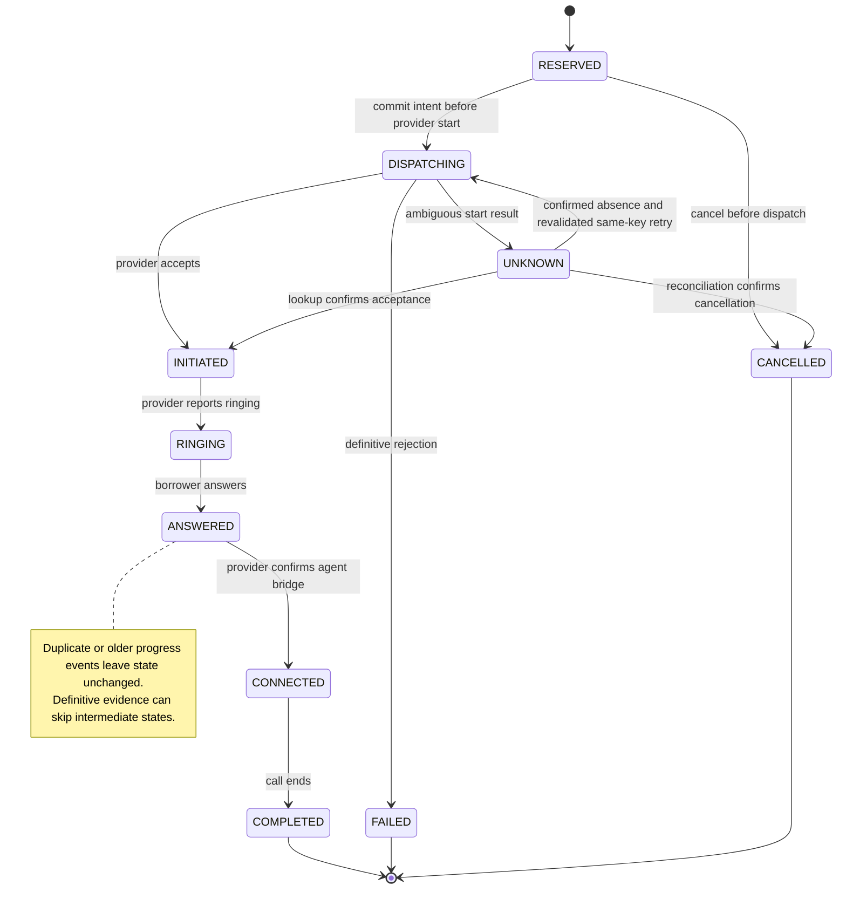

# Call state machine

An eligible borrower represents queued work. Either pacing mode submits a count to the Safety Controller. Approval creates a `RESERVED` attempt and a `READY` job in the same transaction. The worker commits `DISPATCHING` and `dispatch_started_at`, then calls the provider. A provider outcome or callback supplies separate evidence of acceptance.

The diagram shows the normal and recovery paths. The validator also allows a valid later provider milestone to arrive first.

| Current state | Additional valid targets beyond the arrows shown |
| --- | --- |
| `DISPATCHING` | `RINGING`, `ANSWERED`, `CONNECTED`, `COMPLETED`, `CANCELLED` |
| `UNKNOWN` | `RINGING`, `ANSWERED`, `CONNECTED`, `COMPLETED`, `FAILED` |
| `INITIATED` | `ANSWERED`, `CONNECTED`, `COMPLETED`, `FAILED`, `CANCELLED` |
| `RINGING` | `CONNECTED`, `COMPLETED`, `FAILED`, `CANCELLED` |
| `ANSWERED` | `COMPLETED`, `FAILED`, `CANCELLED` |
| `CONNECTED` | `FAILED`, `CANCELLED` |

A timeout can mean that the provider already created the call. The worker keeps both reservations, looks up the same key, and backs off while the answer is unclear. A retry requires authoritative absence, agent eligibility, and an open provider circuit. An expired lease gives another worker a turn at reconciliation. Only definitive termination releases ownership. Provider cancellation seals the key against a delayed start.

Repeated `ANSWERED` deliveries have one effective state change even when provider event IDs differ. If `COMPLETED` arrives before `ANSWERED` and `RINGING`, the attempt stays completed. Earlier facts may enrich its history. After a crash following `ANSWERED`, replay resumes from the inbox or from the already committed answer. Terminal handling closes the job and updates ownership once. A cancellation proven to precede provider acceptance returns the borrower to the queue, while a definitively attempted borrower becomes `done`.

An explicit provider `NO_ANSWER` event or lookup result closes the attempt as `FAILED` with terminal reason `no_answer`. This records a confirmed borrower outcome for predictive history. A generic provider `FAILED`, pre-acceptance rejection, or `UNKNOWN` outcome is excluded from the answer-rate sample. In-flight `UNKNOWN` attempts instead count as one possible future answer each for pacing.

The simulation exercises this lifecycle through the real mock ledger and inbox. It reports each milestone once per attempt despite duplicate callbacks. The `outage` scenario can continue receiving previously scheduled callbacks while start and lookup time out. The `agent_loss` scenario temporarily makes cancellation unavailable so some already dispatched calls can answer after the agent departs. The report distinguishes recorded incidents from incidents inferred using the simulator's departure schedule.
