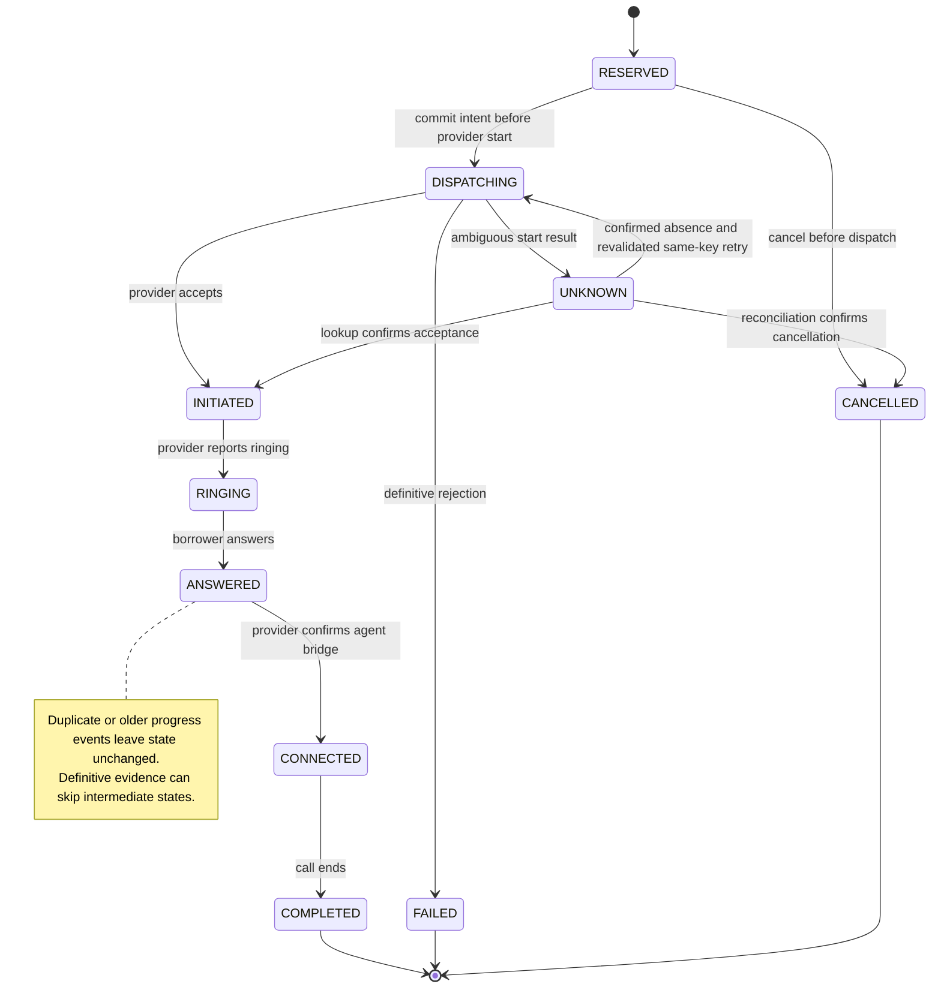

# Call state machine

An eligible borrower represents queued work. The attempt begins in `RESERVED` when an approval is committed. Phase 1 defines the states and validates their edges. The later worker and event handler will enforce the evidence required for each edge.

The diagram shows the normal and recovery paths. The validator also allows a valid later provider milestone to arrive first.

| Current state | Additional valid targets beyond the arrows shown |
| --- | --- |
| `DISPATCHING` | `RINGING`, `ANSWERED`, `CONNECTED`, `COMPLETED`, `CANCELLED` |
| `UNKNOWN` | `RINGING`, `ANSWERED`, `CONNECTED`, `COMPLETED`, `FAILED` |
| `INITIATED` | `ANSWERED`, `CONNECTED`, `COMPLETED`, `FAILED`, `CANCELLED` |
| `RINGING` | `CONNECTED`, `COMPLETED`, `FAILED`, `CANCELLED` |
| `ANSWERED` | `COMPLETED`, `FAILED`, `CANCELLED` |
| `CONNECTED` | `FAILED`, `CANCELLED` |

A timeout can mean that the provider already created the call. The planned worker keeps both reservations, looks up the same key, and waits for authoritative evidence. A retry also requires a fresh safety check. A confirmed cancellation must prevent a late start for the cancelled key before the worker releases ownership.

The event handler will treat repeated `ANSWERED` deliveries as one state change. If `COMPLETED` arrives before `ANSWERED` and `RINGING`, the attempt stays completed and the later deliveries can only enrich its history. After a crash following `ANSWERED`, replay will resume from persisted evidence. The transition validator rejects backward edges, self-transitions, and all transitions out of terminal states. Event handling will recognize duplicates and apply them as no-ops before invoking the validator.
