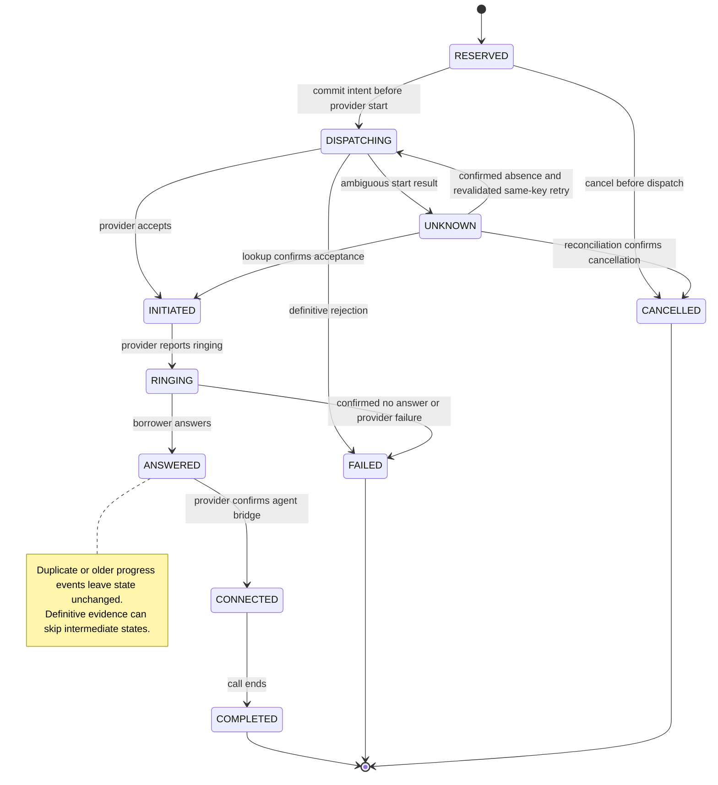

# Call state machine

An eligible borrower represents queued work. Either pacing mode submits a count to the Safety Controller. Approval creates a `RESERVED` attempt and a `READY` job in the same transaction. The worker commits `DISPATCHING` and `dispatch_started_at` as intent before calling the provider. A provider result or callback can separately confirm acceptance.

The diagram shows the normal and recovery paths. The validator also allows a valid later provider milestone to arrive first.

| Current state | Additional valid targets beyond the arrows shown |
| --- | --- |
| `DISPATCHING` | `RINGING`, `ANSWERED`, `CONNECTED`, `COMPLETED`, `CANCELLED` |
| `UNKNOWN` | `RINGING`, `ANSWERED`, `CONNECTED`, `COMPLETED`, `FAILED` |
| `INITIATED` | `ANSWERED`, `CONNECTED`, `COMPLETED`, `FAILED`, `CANCELLED` |
| `RINGING` | `CONNECTED`, `COMPLETED`, `CANCELLED` |
| `ANSWERED` | `COMPLETED`, `FAILED`, `CANCELLED` |
| `CONNECTED` | `FAILED`, `CANCELLED` |

A timeout can mean that the provider already created the call. The worker keeps both reservations, looks up the same key, and backs off while the answer is unclear. A retry requires authoritative absence, current agent and campaign eligibility, and no active provider cooldown. Lookup timeouts on a known live call preserve its recorded progress. An expired lease lets another worker reconcile the outcome. Ownership is released only when the call is definitively closed or dispatch is ruled out. Provider cancellation seals the key against a delayed start.

The validator rejects unlisted transitions, including `RESERVED → RINGING` and any edge out of a terminal state. A cancellation proven to precede provider acceptance returns the borrower to the queue. A definitively attempted borrower becomes `done`.

| Tested callback sequence | Result |
| --- | --- |
| `ANSWERED → ANSWERED → ANSWERED → COMPLETED`, including a replay of the same event ID | One effective answer and one release of ownership |
| `COMPLETED → ANSWERED → RINGING` in delivery order | The call stays `COMPLETED`. Earlier facts can enrich its history |
| `ANSWERED`, worker exits before or after processing it, then `COMPLETED` | The replacement processes the pending answer or starts from the committed answer. Completion closes the job once |

An explicit provider `NO_ANSWER` event or lookup result closes the attempt as `FAILED` with terminal reason `no_answer`. This records a confirmed borrower outcome for predictive history. A generic provider `FAILED`, pre-acceptance rejection, or `UNKNOWN` outcome is excluded from the answer-rate sample. In-flight `UNKNOWN` attempts instead count as one possible future answer each for pacing.

The simulation exercises this lifecycle through the real mock ledger and inbox. It reports each milestone once per attempt despite duplicate callbacks. The `outage` scenario can continue receiving previously scheduled callbacks while start and lookup time out. The `agent_loss` scenario temporarily makes cancellation unavailable so some already dispatched calls can answer after the agent departs. The report distinguishes recorded incidents from incidents inferred using the simulator's departure schedule.
